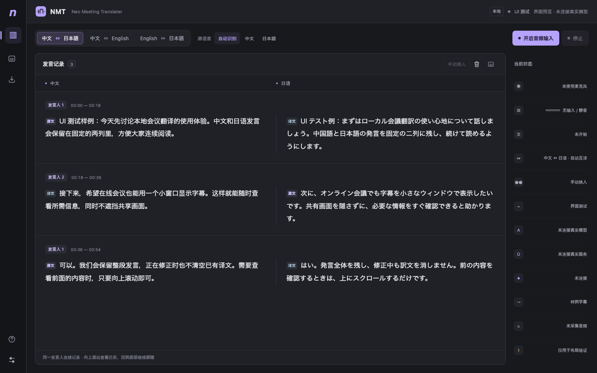
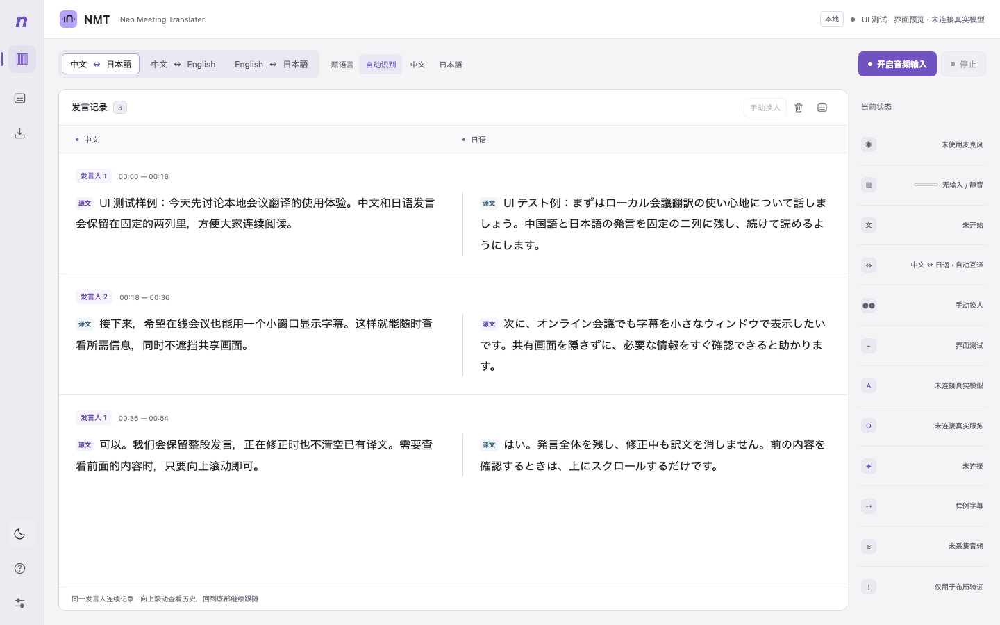

# NMT · Neo Meeting Translater

Local meeting transcription and bilingual subtitles for macOS.

**English** | [简体中文](README.zh-CN.md)

[Download](https://github.com/elizzzzzz/Neo-Meeting-Translater/releases/latest) · [Release notes](docs/release-0.2.20.md) · [Report an issue](https://github.com/elizzzzzz/Neo-Meeting-Translater/issues) · [Apache-2.0](LICENSE)

**Model selection references:** [Apple M3 / 16 GiB (with reviewed quality scores)](docs/model-benchmark-2026-11-09-m3-16gb.md) · [Apple M5 / 32 GiB (7 fully reviewed configurations, November 19, 2026)](docs/model-benchmark-2026-11-19-m5-32gb.md) · [Historical high-memory test dashboard](docs/model-benchmark-highmem-dashboard.md)

32 GB MacBook candidates, measured on an **M5 MacBook Air / 32 GiB / macOS 26.7.3**. All three candidates below have complete 144-case quality reviews; the full ranking includes seven configurations.

| Selection goal | Configuration | Overall | Quality | Mean decode TPS | Median sentence latency | Peak process-tree RSS |
| --- | --- | ---: | ---: | ---: | ---: | ---: |
| Highest overall among reviewed configurations | Qwen3 30B-A3B Q4_K_M / Ollama | 95.39 | 94.58 | 53.26 | 1.03 s | 17.67 GiB |
| Highest quality among reviewed configurations; more headroom | Qwen3.5 9B Q4_K_M / Ollama | 91.37 | 96.25 | 21.81 | 2.32 s | 7.94 GiB |
| Small SGLang candidate; second overall | Qwen3.5 4B MLX 4bit / SGLang | 92.94 | 93.74 | 38.80 | 1.25 s | 5.35 GiB |

Text collection is complete for 39/40 configurations. Seven have complete quality reviews and are ranked; 32 incompletely reviewed configurations and one backend failure are excluded. Grading is label-hidden assistant review, without independent human validation. The three candidates have 8, 7 and 17 critical-error cases, respectively. Image input is untested. RSS is not dedicated VRAM; concurrent ASR has not been validated. SGLang uses local patches and ran with substantial system swap. See the [full 32 GiB table, limitations and evidence](docs/model-benchmark-2026-11-19-m5-32gb.md) (Chinese).

NMT turns microphone or routed meeting audio into paired original and translated text, using speech recognition and translation models on your Mac. It supports Chinese, Japanese and English, with a compact desktop workspace and a floating subtitle window for use alongside meetings and videos.

Current release: **0.2.20** · **Apple Silicon (arm64)** · **Text output first**



<details>
<summary>Light appearance</summary>



</details>

## Features

- **Three bilingual pairs:** Chinese ↔ Japanese, Chinese ↔ English, English ↔ Japanese. The selected pair sets the two language columns; source and translation indicators follow the speaker's language.
- **Readable conversation history:** continuous speech paragraphs, revisable source text, incremental translations, scrolling history and UTF-8 text export.
- **Language controls:** automatic source-language detection within the selected pair, plus quick buttons to lock the language when detection is uncertain.
- **Subtitle mode:** a translucent, movable, resizable, always-on-top window with both columns, original text only or translation only.
- **Local engine selection:** Apple SpeechAnalyzer, MLX Whisper or SenseVoice for speech recognition; Ollama, llama.app or a compatible SGLang service for translation.
- **Speaker labels:** optional local speaker differentiation with anonymous labels; it does not obtain participant names from meeting apps.
- **Desktop controls:** Chinese, Japanese and English interface languages; light, dark and system appearance; saved settings, model status and single-instance startup.

## Requirements

| Component | Requirement |
| --- | --- |
| Computer | Apple Silicon Mac; the archived translation evaluation uses an M3 with 16 GB unified memory; the 32 GB performance reference uses an M5 MacBook Air with 32 GB unified memory |
| App package | arm64 ZIP or DMG; no Intel build is provided |
| Speech recognition | Locally available model files, or macOS 26+ with Apple SpeechAnalyzer language resources |
| Translation | A local Ollama, llama.app or compatible SGLang service with a suitable model |
| Audio | Microphone permission; a separately installed loopback device for meeting or browser playback audio |
| Development | Python 3.11+; Node.js for frontend tests; Swift tools for building the Apple speech helper |

Memory use and latency depend on the selected models and other running applications. SGLang integration provides a local service client; NMT does not install or guarantee a particular SGLang runtime on Apple Silicon.

## Download and run

1. Open the [latest release](https://github.com/elizzzzzz/Neo-Meeting-Translater/releases/latest).
2. Download **`NMT-portable.zip`**, extract it and open **`NMT.app`**. No installer or move to Applications is required. Alternatively, open **`NMT.dmg`** and copy the App to a local folder.
3. Allow microphone access when you start capturing audio. See [macOS installation and permissions](docs/macos-install.md) for more detail (Chinese).

The release also includes `NMT-0.2.20.sha256`. Place it with both downloaded archives and verify them:

```bash
shasum -a 256 -c NMT-0.2.20.sha256
```

The App uses a native macOS window and does not launch a separate browser. Current packages are ad-hoc signed and are **not Apple-notarized**. Close the previous version before upgrading. Existing configuration and permission identifiers are preserved, including the legacy `LocalMeetingInterpreter` Application Support directory.

Repository and download access follow the repository's current GitHub visibility and permissions.

## First-time setup

1. Open **Settings → Models and services** and choose a speech-recognition engine.
2. Select the local recognition model and its directory. Apple language resources are managed by macOS rather than this directory.
3. Choose Ollama, llama.app or SGLang; set its local service address and select an installed translation model. Start the service if it is not running.
4. Choose a language pair and an audio input device, then click **Save and return**.
5. Wait for the model status to show ready before starting transcription.

Settings apply without manually restarting the App. Applying them during capture temporarily pauses audio while the engines switch. Returning users with saved configuration enter the workspace without repeating setup.

The App provides explicit actions for Ollama installation or upgrade and supported model downloads. Starting the App, opening settings or refreshing the model list does not automatically install models or upgrade services. Packages contain **no model weights**. Model files remain under the selected directories or the relevant engine's management; changing a path does not migrate existing files.

For engine-specific options and source configuration, see the [model setup guide](docs/model-setup.zh-CN.md) (Chinese).

## Meeting and browser audio

NMT captures **one input device at a time**:

- **In-person speech:** select the Mac microphone or a headset microphone.
- **Tencent Meeting, Microsoft Teams or browser video:** route playback through a separately installed virtual audio device such as BlackHole or Loopback, then select that device in NMT.
- **Listen while transcribing:** configure a macOS Multi-Output Device to send playback to both headphones and the loopback device.

NMT does not directly access internal audio channels or cloud transcription APIs in meeting apps. Local microphone and remote meeting audio require an externally mixed input if both are needed together. See the [audio routing guide](docs/macos-meeting-audio.md) (Chinese).

## Privacy and network access

Speech recognition and translation run locally when configured with local engines and models. The built-in service integrations use loopback HTTP endpoints. NMT does not send meeting audio or transcript text to a cloud transcription or translation API.

Environment checks, version checks, explicitly requested downloads and updates can access external services. Prepare the required models and language resources in advance for offline use. Exports are saved to a location chosen by the user; treat exported meeting records as sensitive data.

## Current limitations

- This is an early release. Translation speech output is not complete; the delivered workflow prioritizes text subtitles.
- Recognition, language detection and speaker differentiation can make errors, especially with noise, short utterances or overlapping speech. Review exported records before relying on them.
- Apple SpeechAnalyzer requires macOS 26+. Its bilingual detection uses experimental application-level candidate comparison; source-language buttons provide a manual fallback.
- Real microphone capture and Tencent Meeting / Teams routing need validation on each target setup. Playback benchmarks do not establish acceptance of those capture paths.
- The target of roughly one second for recognition plus one additional second for translation is not guaranteed. Model preparation, corrections, audio length and system load affect latency.

Earlier Chinese and Japanese playback measurements, including methodology and limitations, are available in the [ASR evaluation](docs/asr-evaluation-0.2.3.md) and [streaming evaluation](docs/asr-evaluation-0.2.4.md). They do not establish performance for every engine or the current release.

## Development

```bash
git clone https://github.com/elizzzzzz/Neo-Meeting-Translater.git
cd Neo-Meeting-Translater
python3 -m venv .venv
source .venv/bin/activate
pip install -e '.[dev]'
python -m meeting_interpreter --mock
```

`--mock` is a development mode with simulated results, not real recognition. To run the desktop App with local engine dependencies:

```bash
pip install -e '.[apple,audio,speaker]'
export MEETING_INTERPRETER_MODE=local
python -m meeting_interpreter.desktop
```

Configure the real models through Settings. Run tests and build arm64 packages:

```bash
pytest -q
node --test tests/frontend.test.cjs
pip install -e '.[apple,audio,installer,speaker]'
./scripts/build_macos_app.sh
```

Build outputs: `dist/NMT.app`, `dist/NMT-portable.zip` and `dist/NMT.dmg`. The Python package, environment-variable prefix and bundle identifier retain their historical names for compatibility. Architecture details are in [Streaming architecture](docs/streaming-architecture.md) (Chinese).

## Support and contributions

Use [GitHub Issues](https://github.com/elizzzzzz/Neo-Meeting-Translater/issues) to report reproducible problems or propose improvements. Include the App version, macOS version, selected engines, relevant status messages and reproduction steps. Remove private transcripts, audio, credentials and personal filesystem paths from reports. Contributions should describe the change and its validation; do not commit model weights or meeting recordings.

## License and attribution

NMT's original code and documentation are licensed under the **[Apache License 2.0](LICENSE)**. Commercial use, modification and redistribution are permitted subject to its terms. When redistributing, include the license, retain applicable copyright and attribution notices, carry forward the relevant [NOTICE](NOTICE), and identify modified files as required by the license.

Suggested credit:

> Based on NMT (Neo Meeting Translater) by elizzzzzz and contributors. Source: https://github.com/elizzzzzz/Neo-Meeting-Translater — Apache License 2.0.

Third-party libraries, model weights, language resources and evaluation material retain their own licenses. The NMT license does not relicense them or grant rights to third-party names or trademarks. See [Third-party notices](THIRD_PARTY_NOTICES.md).
