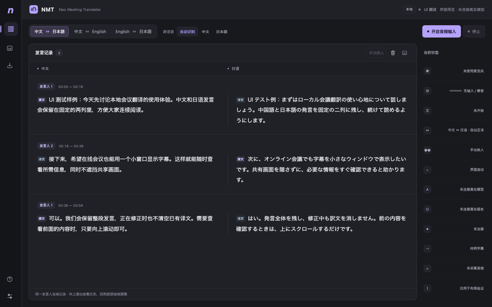
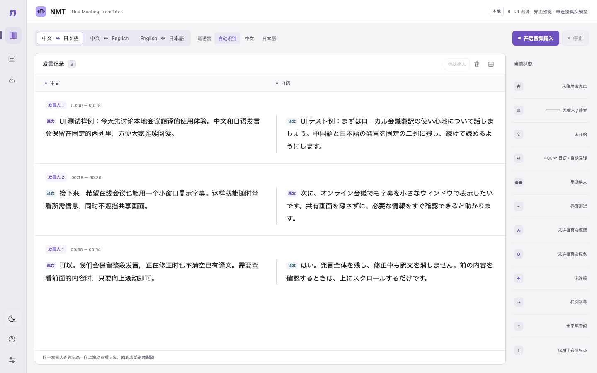

# NMT · Neo Meeting Translater

在 Mac 上本地运行的会议语音识别与双语字幕工具。

[English](README.md) | **简体中文**

[下载](https://github.com/elizzzzzz/Neo-Meeting-Translater/releases/latest) · [版本说明](docs/release-0.2.20.md) · [反馈问题](https://github.com/elizzzzzz/Neo-Meeting-Translater/issues) · [Apache-2.0](LICENSE)

NMT 将麦克风或经音频回环接入的会议声音转换为原文与译文，使用 Mac 上的语音识别与翻译模型处理。支持中文、日语和英语，提供双栏发言记录和可置顶的半透明字幕浮窗，适用于现场会议、在线会议和视频观看。

当前版本：**0.2.20** · **Apple Silicon（arm64）** · **文字字幕优先**



<details>
<summary>查看亮色界面</summary>



</details>

## 主要功能

- **三组双向翻译**：中文 ↔ 日语、中文 ↔ 英语、英语 ↔ 日语。两侧语言顺序固定，“源 / 译”标志随当前发言语言切换。
- **连续发言记录**：保留段落、支持原文修订与译文增量更新，可滚动查看历史并导出 UTF-8 文本。
- **快捷语言控制**：在选定语言对内自动判断源语言，判断不准确时可用按钮锁定当前语言。
- **字幕模式**：半透明、置顶、可移动、可缩放；支持双栏、仅原文或仅译文。
- **本地引擎选择**：语音识别支持 Apple SpeechAnalyzer、MLX Whisper、SenseVoice；翻译支持 Ollama、llama.app 和兼容的 SGLang 本机服务。
- **发言人标签**：可选本地说话人区分，以匿名标签显示，不读取会议软件中的真实姓名。
- **桌面体验**：中文、日语、英语界面；亮色、暗色及跟随系统；保存设置、模型状态提示和单实例启动。

## 运行要求

| 项目 | 要求 |
| --- | --- |
| 电脑 | Apple Silicon Mac；当前开发与评估设备为 M3 / 16 GB 统一内存 |
| 安装包 | arm64 ZIP 或 DMG，暂未提供 Intel 版本 |
| 语音识别 | 本机模型文件，或 macOS 26+ 的 Apple SpeechAnalyzer 语言资源 |
| 翻译 | 已安装模型的本机 Ollama、llama.app 或兼容 SGLang 服务 |
| 音频 | 麦克风权限；在线会议和网页播放音频需要另装音频回环设备 |
| 开发 | Python 3.11+；前端测试需要 Node.js；构建 Apple 语音助手需要 Swift 工具链 |

内存占用与延迟取决于模型大小和其他程序的负载。SGLang 接入提供本地服务客户端，NMT 不负责安装或保证特定 SGLang 运行环境在 Apple Silicon 上可用。

## 下载与运行

1. 打开 [最新版本发布页](https://github.com/elizzzzzz/Neo-Meeting-Translater/releases/latest)。
2. 下载 **`NMT-portable.zip`**，解压后双击 **`NMT.app`**，无需安装或移入 Applications。也可打开 **`NMT.dmg`**，将 App 复制到本机目录。
3. 开始采集音频时允许麦克风访问。详情见 [macOS 安装与权限说明](docs/macos-install.md)。

发布页同时提供 `NMT-0.2.20.sha256`。将它和两个安装包放在同一目录，执行：

```bash
shasum -a 256 -c NMT-0.2.20.sha256
```

App 使用原生 macOS 窗口，不另开浏览器。当前安装包采用临时签名，**尚未通过 Apple 公证**。升级前请关闭旧版；现有配置和权限身份继续保留，包括历史名称 `LocalMeetingInterpreter` 对应的 Application Support 目录。

仓库与下载的访问范围以 GitHub 当前的可见性和访问权限为准。

## 首次配置

1. 打开“设置 → 模型与服务”，选择语音识别引擎。
2. 选择本地语音模型及目录。Apple 语言资源由 macOS 管理，不受这个目录控制。
3. 选择 Ollama、llama.app 或 SGLang，填写本机服务地址并选择已安装的翻译模型；服务未运行时先启动服务。
4. 选择语言对与音频输入设备，点击“保存并返回”。
5. 等待模型状态显示可用后，开始识别。

设置无需手动重启即可应用。录音中应用设置时，会短暂停止收音以切换引擎。已有配置的用户再次打开时直接进入工作区，无需重复设置。

界面提供 Ollama 安装 / 升级和受支持模型下载的明确操作。打开 App、进入设置或刷新模型列表不会自动安装模型或升级服务。安装包**不包含模型权重**；模型文件保留在指定目录或由对应引擎管理，修改路径不会迁移已有文件。

各引擎配置和源码环境变量见 [模型与本地服务配置](docs/model-setup.zh-CN.md)。

## 在线会议与网页音频

NMT **一次采集一个输入设备**：

- **现场发言**：选择 Mac 内置麦克风或耳机麦克风。
- **腾讯会议、Microsoft Teams、网页视频**：通过另行安装的 BlackHole 或 Loopback 等虚拟音频设备路由播放声音，再在 NMT 中选择对应输入。
- **同时听到原声**：在 macOS“音频 MIDI 设置”中创建多输出设备，将声音同时送至耳机和回环设备。

NMT 不直接读取会议软件内部音频通道，也不调用其云端转写接口。若需同时采集本机麦克风与远端声音，需要先由外部混音设备合并输入。详见 [会议音频接入指南](docs/macos-meeting-audio.md)。

## 隐私与网络访问

配置本地引擎和模型后，语音识别与翻译在本机执行；内置服务接入使用本机回环 HTTP 地址。NMT 不将会议音频或字幕发送到云端识别、翻译 API。

环境检测、版本检查，以及用户明确发起的下载和更新可能访问外部服务。如需离线使用，请提前准备模型与语言资源。会议记录由用户选择导出位置，请妥善保管导出文件。

## 当前限制

- 当前属于早期版本，翻译语音输出尚未完成，交付功能以文字字幕为主。
- 噪声、短句和多人重叠发言可能影响识别、语言判断及说话人区分；正式使用前请复核导出内容。
- Apple SpeechAnalyzer 需要 macOS 26+；双语自动判断采用实验性的应用层候选比较，可用源语言按钮手动纠正。
- 真实麦克风、腾讯会议和 Teams 的音频路由需要在各目标设备验证，回放测试不等于这些采集路径已验收。
- 无法保证始终达到“识别约一秒、翻译再增加一秒”的目标；模型准备、文本修订、音频长度和系统负载均会影响延迟。

历史中日语音回放结果、方法与限制见 [识别评估](docs/asr-evaluation-0.2.3.md) 和 [流式评估](docs/asr-evaluation-0.2.4.md)。这些结果不代表所有引擎或当前版本的整体表现。

## 开发与构建

```bash
git clone https://github.com/elizzzzzz/Neo-Meeting-Translater.git
cd Neo-Meeting-Translater
python3 -m venv .venv
source .venv/bin/activate
pip install -e '.[dev]'
python -m meeting_interpreter --mock
```

`--mock` 为开发模拟模式，输出并非真实识别。使用本地引擎启动桌面 App：

```bash
pip install -e '.[apple,audio,speaker]'
export MEETING_INTERPRETER_MODE=local
python -m meeting_interpreter.desktop
```

在设置中连接真实模型。测试和构建 arm64 安装包：

```bash
pytest -q
node --test tests/frontend.test.cjs
pip install -e '.[apple,audio,installer,speaker]'
./scripts/build_macos_app.sh
```

产物为 `dist/NMT.app`、`dist/NMT-portable.zip` 和 `dist/NMT.dmg`。Python 包名、环境变量前缀及 bundle identifier 保留历史命名以兼容现有配置。架构细节见 [流式处理说明](docs/streaming-architecture.md)。

## 反馈与贡献

欢迎通过 [GitHub Issues](https://github.com/elizzzzzz/Neo-Meeting-Translater/issues) 反馈可复现的问题或提出改进建议。请附 App 版本、macOS 版本、所选引擎、相关状态信息及复现步骤；提交前移除私人会议内容、录音、凭据和个人文件路径。代码贡献应说明变更及验证方式，请勿提交模型权重或会议录音。

## 商用授权与署名

NMT 原创代码与文档采用 **[Apache License 2.0](LICENSE)**，允许商业使用、修改和分发，须遵守许可证条款。再分发时请附许可证、保留适用的版权与署名信息、保留相关 [NOTICE 声明](NOTICE)，并按许可证要求标明修改过的文件。

推荐署名：

> 基于 NMT（Neo Meeting Translater），作者 elizzzzzz 及贡献者。项目来源：https://github.com/elizzzzzz/Neo-Meeting-Translater ，采用 Apache License 2.0。

第三方依赖、模型权重、系统语言资源和评估材料分别遵循原有许可证，NMT 的许可证不会改变其授权，也不授予第三方名称或商标的使用权。详见 [第三方说明](THIRD_PARTY_NOTICES.md)。
